<!--
  Diseño del perfil: las imágenes de assets/ las genera tools/ (cd tools && npm ci && npm run build).
  assets/activity.svg se actualiza solo cada día con .github/workflows/activity.yml.
-->

  

  
  
  

  Desarrollador full-stack freelance en Ciudad de México, disponible para proyectos. 
  Estudio Ingeniería en Computación en la UAM Cuajimalpa.

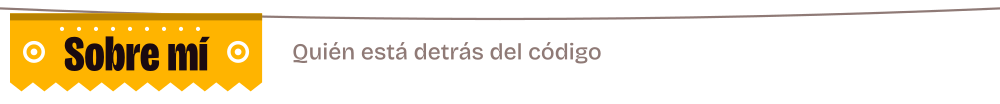


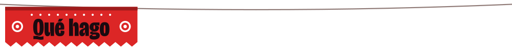


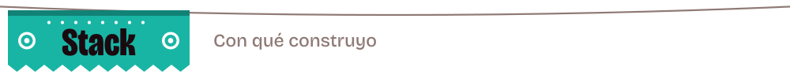

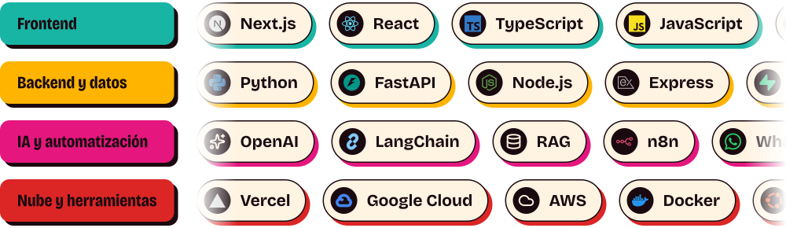

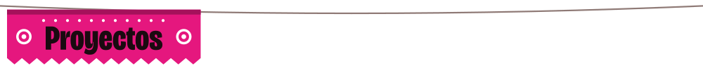

  <a href="https://salzoom.com">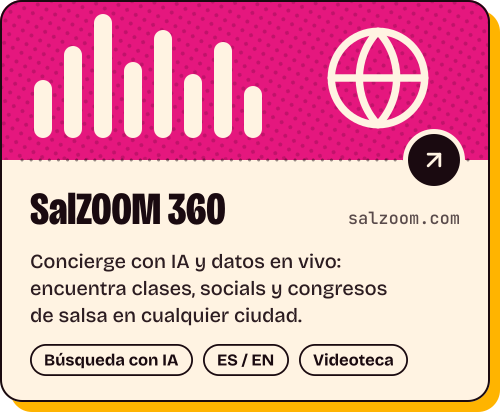</a>
  <a href="https://contiggo.app">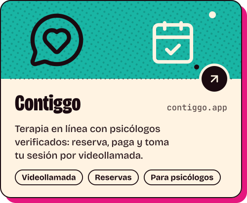</a>
   
  <a href="https://triaestalvi.com">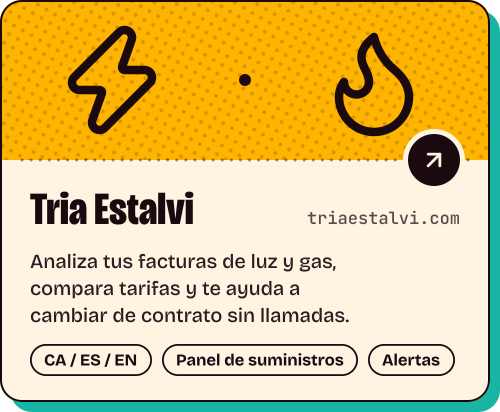</a>
  <a href="https://elementio.mx">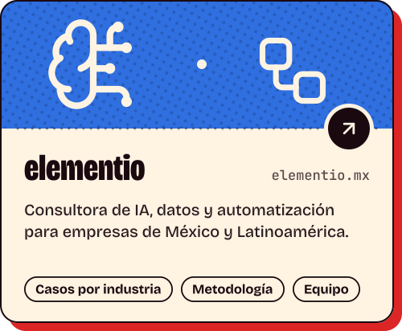</a>

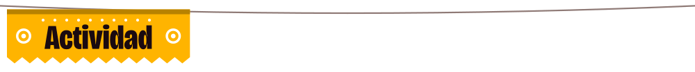

  <a href="https://github.com/maxitodev">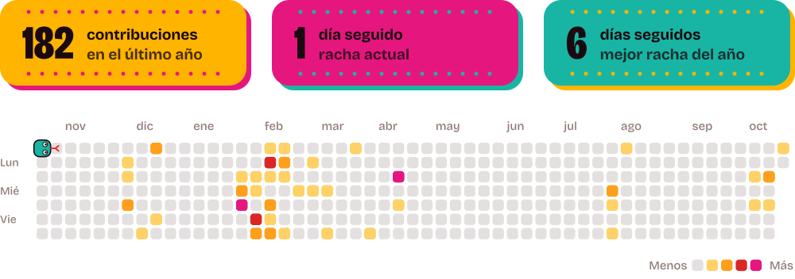</a>

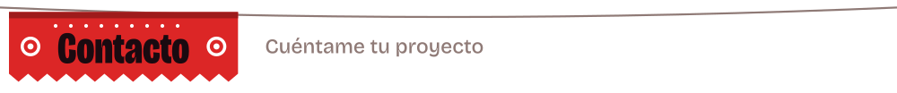

  
  
  

